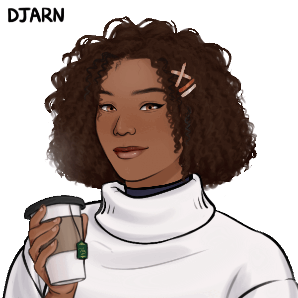

<h2 align="center">
Olá Mundo!👋🏾   
</h2> 

  

   
    Me chamo Paloma, tenho 25 anos e sou de Salvador, Bahia.  
    Sou <strong>Bacharel em Ciência e Tecnologia</strong> e atualmente discente do curso de <strong>Sistemas de Informação</strong>.  
     
    Tenho direcionado meus estudos para a área de <strong>Qualidade de Software (QA)</strong>, com foco em apoiar a qualidade de produtos digitais por meio da criação de cenários de teste, validação de fluxos e atenção aos requisitos e à experiência do usuário.
     
    Além da graduação em andamento, busco constantemente aprofundar meus conhecimentos por meio de estudos autônomos, cursos e projetos práticos, desenvolvendo uma base sólida em conceitos de qualidade, análise de requisitos, cenários de teste e visão crítica sobre o comportamento do sistema.  
   

 

##

  Essas são as tecnologias que estou me aperfeiçoando atualmente:

 
  
  
  
  
  
  
  
  
  
  

##

 
  Vamos nos conectar? 
</h5>
  
   

